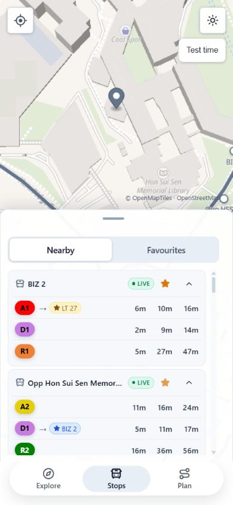
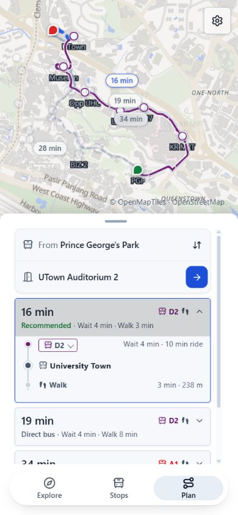
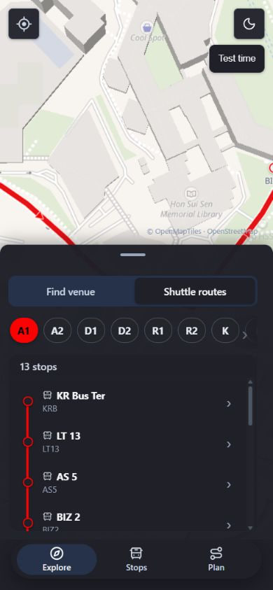
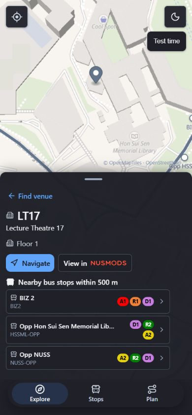

# NavUS

An experimental campus-navigation prototype for the National University of Singapore. Explore venues and shuttle routes, plan estimated walking-and-bus journeys, and check shuttle arrivals.

Journey planning needs a running Valhalla service. Live shuttle arrivals need server-side NUS settings. See [project status](docs/project-status.md) for current capabilities and limitations.

## Demo

Try the [static GitHub Pages demo](https://limzijing.github.io/NavUS/). It uses static shuttle timing estimates; live arrivals require server-side NUS settings.

## Screenshots

| Nearby stops | Live journey |
| --- | --- |
|  |  |

| Shuttle routes (dark) | LT17 venue details (dark) |
| --- | --- |
|  |  |

## Run locally

Requirements: Node.js 22 or later, npm, and Docker Desktop with Docker Compose.

```bash
npm install
npm run dev
```

The root command starts Vite, Express, and local Valhalla. On the first run, Docker downloads map data and builds routing tiles; this can take several minutes and use local disk space.

## Optional live data

Copy `.env.example` to `.env` for frontend settings and `backend/.env.example` to `backend/.env` for Express settings and provider credentials. Keep credentials server-side; variables prefixed with `VITE_` are included in the browser build.

## Useful commands

```bash
npm test
npm run lint
npm run build
npm run preview
```

For detailed arrival timing behavior, see [shuttle timing](docs/shuttle-timing.md). The [manual smoke checklist](docs/qa/manual-smoke-check.md) covers the main user flows.

The map uses the OpenFreeMap Liberty style and OpenStreetMap data. Attribution appears in the app. Review OpenFreeMap's usage terms before deploying publicly or at scale.
